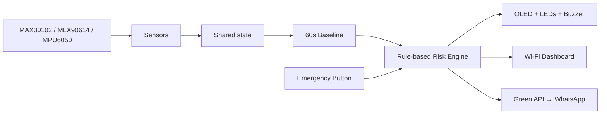

# ESP32 AI-Assisted Patient Triage Monitor

> **Educational prototype only — not for medical decision-making or emergency response.**

A modular, GitHub-ready refactor of a working Arduino ESP32 patient-monitoring sketch. The project keeps the original monitoring, OLED, LED/buzzer, local dashboard, and WhatsApp alert flow, but separates firmware components and moves Wi-Fi / Green API configuration into an ignored local `.env` file.

**Data provenance:** Bed 1 reads hardware sensors. **Beds 2 and 3 are simulated** for the dashboard demonstration. The health score uses hand-written rules, not a trained AI model.

## Features

- MAX30102: optical heart rate / SpO2 estimate
- MLX90614: IR object temperature
- MPU6050: motion/shake warning, labeled "fall" in prototype UI
- SSD1306 OLED via U8g2
- 60-second baseline calibration and threshold-based demo health score
- Green/yellow/red LEDs, buzzer, emergency push button
- Mobile-friendly ESP32 HTTP dashboard with three beds and trends
- Green API WhatsApp alert attempts for doctor and family contacts
- Local `.env` configuration with a `.gitignore` guard

## Repository layout

```text
ESP32_AI_Patient_Triage_Monitor/
├── .env.example                 # Safe credential template
├── .gitignore                   # Ignores credentials, generated files, and build artifacts
├── platformio.ini               # ESP32 DevKit + library dependencies
├── README.md
├── docs/
│   ├── wiring.md                # Pin table and sensor addresses
│   └── behavior-and-limitations.md
├── include/
│   ├── Config.h                 # Pin addresses and timing constants
│   ├── AppState.h               # Shared data model
│   └── *.h                      # Module interfaces
├── src/
│   ├── main.cpp                 # setup() / loop()
│   ├── Sensors.cpp              # MAX30102, MLX90614, MPU6050
│   ├── Baseline.cpp             # Calibration and history
│   ├── RiskEngine.cpp           # Health score & status
│   ├── Display.cpp              # OLED
│   ├── Alerts.cpp               # Button, LEDs, buzzer
│   ├── WhatsApp.cpp             # Messaging
│   ├── Dashboard.cpp            # Web routes & JSON API
│   ├── Utils.cpp                # Clock and JSON escaping
│   └── AppState.cpp
├── web/
│   ├── index.html               # Dashboard markup
│   ├── styles.css               # Styling
│   └── app.js                   # Graphing and updates
└── scripts/
    └── prebuild.py              # Embeds .env & web assets into ignored headers
```

## How to build and upload (VS Code + PlatformIO)

1. Install **Visual Studio Code** and the **PlatformIO IDE** extension.
2. Extract this ZIP, then choose **PlatformIO: Open Project** and select this repository's **root folder** (the folder with `platformio.ini`).
3. Copy `.env.example` to `.env` in the root directory and replace *every placeholder* with your own values. **Do not upload `.env` to GitHub.**
4. Plug in your ESP32 DevKit via USB. The example `board = esp32dev` assumes a classic ESP32 DevKit. Adjust the board and serial port in `platformio.ini` if needed.
5. Run **PlatformIO: Build**. The pre-build script creates ignored `include/GeneratedSecrets.h` and `include/GeneratedAssets.h`; you do not create them manually. No separate filesystem upload is needed.
6. Run **PlatformIO: Upload**, then **PlatformIO: Monitor** at `115200` baud.
7. Check the Serial Monitor for `ESP32 IP:` and open `http://<ESP32-IP>/` from a browser connected to the *same* local network.

The original sketch used the Arduino IDE. This refactor is a **PlatformIO project**, not a single `.ino` sketch. It needs PlatformIO (or a manual conversion of modules to an Arduino sketch). The ESP32 firmware still uses the Arduino framework.

## .env values

| Key | Description |
|---|---|
| `WIFI_SSID` | Your local hotspot / Wi-Fi network |
| `WIFI_PASS` | Wi-Fi password |
| `GREEN_API_URL` | `https://<subdomain>.api.greenapi.com` for your Green API instance |
| `GREEN_ID_INSTANCE` | Your Green API instance identifier |
| `GREEN_API_TOKEN` | Your **newly regenerated** API token |
| `DOCTOR_CHAT_ID` | Doctor/demo phone in `91XXXXXXXXXX@c.us` format |
| `FAMILY_CHAT_ID` | Family/demo phone in the same format |

**IMPORTANT:** The original sketch contained a real-looking Green API token and Wi-Fi password. Treat these as compromised; **rotate/revoke the token and change the Wi-Fi password** before sharing code/screenshots or demonstrating the system. The archive intentionally includes none of those values. Even though `.env` is gitignored, credentials still end up embedded in uploaded firmware.

## Modules and behavior


## Before pushing to GitHub

In the project root:

```bash
git init
git add .
git status                    # Ensure .env and GeneratedSecrets.h are NOT listed
git commit -m "Modular ESP32 patient triage monitor"
git branch -M main
git remote add origin https://github.com/YOUR_USERNAME/YOUR_REPO.git
git push -u origin main
```

If your GitHub repo already contains a README or commits, do **not** blindly force-push. Clone that repo, copy these project files into the clone, then commit/push so its existing history is kept.

## Notes on reliability

The refactor keeps the original scoring and dashboard values rather than claiming clinical accuracy. To preserve the hardware behavior, movement warnings last about 5 seconds, baseline time is 60 seconds, and Beds 2–3 are simulated. One minor defensive change was added: the optical sensor read has a timeout to avoid hanging forever if samples stop arriving.

The `MPU6050.h` dependency from the original sketch was unnecessary because the original MPU readings already used direct I2C registers; the refactor keeps those same register reads without the unused library.
